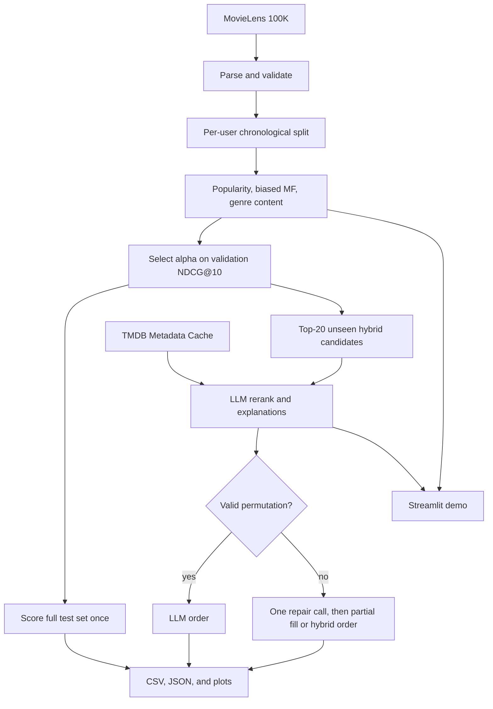

# Hybrid Movie Recommendation Using Matrix Factorization and LLM Reranking

## Team FA26-Group14-Project8

| Member             | Email            |
| ------------------ | ---------------- |
| Sarthak Mishra     | smish147@asu.edu |
| Siddanagouda Patil | spati193@asu.edu |
| Travis Andring     | tandring@asu.edu |
| Shashwat Dwivedi   | sdwive18@asu.edu |
| Dhanashree Somani  | dsomani3@asu.edu |

## Repository Structure

Course rubric submission directory mapping:
- **Code:** `src/`, `scripts/`, `app/`, `tests/`
- **Data:** [data/README.md](data/README.md) details retrieval and preprocessing; [data/processed/split_summary.json](data/processed/split_summary.json) and [data/processed/genre_names.json](data/processed/genre_names.json) store split metadata. Raw MovieLens 100K and TMDB metadata are downloaded locally using the provided scripts.
- **Evaluations:** `artifacts/metrics/` and `artifacts/plots/` (Stage 1 and Stage 2 tables, 6-job ablations, 50-row explanation audit, and charts)

## Overview and Research Question

This repository builds and evaluates a two-stage movie recommendation pipeline on MovieLens 100K. Stage 1 trains classical popularity, biased matrix factorization, genre content, and hybrid models to retrieve a top-20 candidate set per user. Stage 2 uses a zero-shot LLM reranker enriched with TMDB metadata to reorder those candidates and generate one-sentence, history-grounded explanations.

Our core research question is straightforward: can zero-shot LLM reranking improve ranking accuracy, beyond-accuracy metrics (novelty, coverage, popularity bias), or explanation quality over a classical hybrid recommender? Our evaluation treats negative or statistically inconclusive findings as valid outcomes and reports paired 95% bootstrap confidence intervals rather than assuming an LLM will win.

| ID  | System                      | What it uses                                                              |
| --- | --------------------------- | ------------------------------------------------------------------------- |
| 1   | Popularity                  | Training rating counts and a Bayesian average                             |
| 2   | Biased matrix factorization | Collaborative ratings via PyTorch embeddings                              |
| 3   | Genre content               | 19-dimensional multi-hot genres and weighted user profiles                |
| 4   | Hybrid                      | Per-user min-max normalized MF + content, tuned on validation alpha       |
| 5   | Hybrid + LLM rerank         | Top-20 hybrid candidates reordered by an OpenAI-compatible LLM            |
| 6   | Grounded explanations       | One-sentence history-linked pitches with deterministic template fallbacks |

## Architecture



All HTTP provider logic sits inside `OpenAICompatibleClient` in [src/movie_recommender/llm/client.py](src/movie_recommender/llm/client.py). `OpenAICompatibleClient` works with any standard OpenAI-compatible API endpoint simply by updating `LLM_BASE_URL`, `LLM_API_KEY`, and `LLM_MODEL` in `.env`. To plug in a non-OpenAI provider later, implement `ChatClient.chat` and pass it into `LLMGateway`, which handles SQLite caching, request pacing, retries, and call budgets automatically.

## Dataset and TMDB Enrichment

The core dataset is **MovieLens 100K**: 100,000 integer ratings (1 to 5) from 943 users across 1,682 movies, collected by GroupLens between September 1997 and April 1998. Every user has at least 20 ratings.

- `u.data`: tab-separated `user_id`, `movie_id`, `rating`, and Unix `timestamp`.
- `u.item`: pipe-delimited movie metadata read as `latin-1`. The original GroupLens README claims this file is tab-separated, while the distributed archive uses pipes, so our parser accepts either delimiter whenever a row contains 24 fields. Release years are extracted from the trailing `(YYYY)` in each title, falling back to the release date column if needed.

MovieLens 100K only provides titles and 19 coarse binary genre flags (`unknown` through `Western`). To test whether richer semantic context helps reranking and explanations, `scripts/fetch_tmdb_metadata.py` enriches the catalog via the TMDB API and caches results locally in `data/processed/tmdb_metadata.json` (1,682 movies indexed, with 1,670 movies or 99.3% carrying plot summaries alongside directors and top cast).

### Data Retrieval Steps
1. **MovieLens 100K:** Run `python scripts/download_data.py` to automatically fetch and extract the official archive into `data/raw/ml-100k` (or download `ml-100k.zip` manually from [GroupLens](https://grouplens.org/datasets/movielens/100k/)). Then run `python scripts/prepare_data.py --data-dir data/raw/ml-100k` to generate the chronological splits.
2. **TMDB Metadata:** Create a free account at [The Movie Database (TMDB)](https://www.themoviedb.org), confirm your verification email, navigate to **Settings** -> **API** on a desktop browser, request a free **Developer (non-commercial)** API key, set `TMDB_API_KEY=<key>` in `.env`, and run `python scripts/fetch_tmdb_metadata.py`. Full details are documented in [data/README.md](data/README.md).

### Attributions and Policies
- Raw MovieLens files (`ml-100k/` and `data/raw/`) and enriched metadata (`data/processed/tmdb_metadata.json`) are gitignored and not redistributed here. Cite Harper and Konstan (2015), _The MovieLens Datasets: History and Context_, ACM TiiS.
- *This product uses the TMDB API but is not endorsed or certified by TMDB.* Visit [https://www.themoviedb.org](https://www.themoviedb.org).
- `artifacts/cache/llm_cache.sqlite` is created locally when running `evaluate_llm.py` and is excluded from version control because it stores MovieLens histories and TMDB plots inside cached prompts.

## Installation

Python 3.11 or newer is required. We built and tested the pipeline on Python 3.12 for stable PyTorch wheel support.

```bash
git clone [https://github.com/sarrrthakkk/movie-recommendation-system.git](https://github.com/sarrrthakkk/movie-recommendation-system.git)
cd movie-recommendation-system

python3.12 -m venv .venv
source .venv/bin/activate
pip install -r requirements.txt
```

`pip install -e .` also works, though every script adds `src/` to `sys.path` automatically so editable installation is optional.

## API Configuration

Copy `.env.example` to `.env` and fill in your local credentials. Never commit `.env`.

```bash
cp .env.example .env
```

```dotenv
LLM_API_KEY=
LLM_BASE_URL=
LLM_MODEL=gemma4-31b-it
TMDB_API_KEY=
```

- We selected **`gemma4-31b-it`** (`temperature = 0.0`, `max_tokens = 512`, hosted on ASU Research Computing) as our primary evaluation model.
- `LLM_BASE_URL` is the server root prefixing `/chat/completions` (for example, `https://openai.rc.asu.edu/v1`). The client posts to `{LLM_BASE_URL}/chat/completions` using `Authorization: Bearer <key>`. `OpenAICompatibleClient` works with any OpenAI-compatible API endpoint by updating `.env`.
- `LLM_MODEL` resolves directly from `.env` and controls the active model ID (also included in every SQLite cache key so runs with different models never collide). We use `gemma4-31b-it` as our selected implementation model. Forced-thinking models (such as `glm-5-3`) can consume the fixed `max_tokens: 512` budget on internal reasoning tokens and truncate JSON output.
- `TMDB_API_KEY` is only needed once to populate `data/processed/tmdb_metadata.json`.

If `LLM_API_KEY` or `LLM_BASE_URL` is missing, live LLM calls stay disabled with a clear warning while all classical models, tests, and the Streamlit cold-start demo continue running. API keys are never written to SQLite, never printed in logs, and stripped if they ever appear in error strings.

## Data Split

A movie counts as relevant if the user rated it 4 or 5. For each user:

1. Sort all interactions by timestamp, breaking ties by `movie_id`.
2. Hold out the latest relevant interaction as the test item.
3. Hold out the second-latest relevant interaction as the validation item.
4. Keep interactions strictly before the validation timestamp as the training set.
5. Drop any user with fewer than 3 relevant ratings in training.

Anything between validation and test, or after the test item, is discarded so no future information leaks into training or evaluation. Running `prepare_data.py` produces **938 eligible users** (5 dropped), **94,527 training ratings**, **938 validation items**, **938 test items**, and **3,597 discarded ratings** (matrix sparsity `0.937`), saved to `data/processed/` and `artifacts/metrics/split_summary.json`.

Validation NDCG@10 governs both matrix-factorization early stopping and hybrid `alpha` selection, and the test split is evaluated once afterward. Sharing a single validation split for epoch stopping and `alpha` tuning can make validation scores slightly optimistic; we accept and disclose that trade-off rather than carving out a third split on a small dataset.

## Models

### Popularity

Fit strictly on training rows, with seen movies filtered out and ties broken by smaller `movie_id`. Two variants are computed:

- **Positive count**: number of training ratings `>= 4`.
- **Bayesian average** (prior strength `C = 10` at training global mean `mu`):
  ```text
  bayes_i = (C * mu + sum of observed training ratings) / (C + n_i)
  ```
  Movies absent from training receive `mu` under the Bayesian score and `0` under positive count.

### Biased Matrix Factorization

```text
r_hat(u, i) = mu + b_u + b_i + p_u · q_i
```

Implemented with PyTorch user/item embeddings and biases, covering every catalog item so cold items still receive a score. Training minimizes mini-batch MSE plus L2 regularization using SGD with gradient clipping at `5.0`, restoring the checkpoint with the best **validation NDCG@10**. Validation and test RMSE/MAE are logged as secondary rating metrics because every validation target is `>= 4`, making rating error a poor proxy for top-K ranking quality. Checkpoints save to `artifacts/models/mf.pt` and `artifacts/models/mf_metadata.json`. Device selection prefers CUDA, then Apple MPS, then CPU (`--smoke` defaults to CPU).

### Genre Content

Each movie is represented by its 19-dimensional binary genre vector. A user's profile is the weighted average of their training movies using `w_ui = max(r_ui - 3, 0)` (rating 4 gets weight 1; rating 5 gets weight 2). Unseen items are ranked by cosine similarity, falling back to Bayesian popularity if a user's profile vector is all zeros.

### Hybrid

MF and content scores are min-max normalized separately per user across their unseen catalog (constant vectors map to `0.5`):

```text
s_hybrid(u, i) = alpha * s_MF(u, i) + (1 - alpha) * s_content(u, i)
```

We select `alpha` from `{0.0, 0.25, 0.5, 0.75, 1.0}` on validation NDCG@10 (ties prefer the value closest to `0.5`, then smaller `alpha`) and apply it once on the test split.

## LLM Reranking and Explanations

The LLM never scans the full 1,682-movie catalog and is never fine-tuned. For each sampled user (100 stratified users: 34 low, 33 medium, 33 high activity), it receives:

- Up to 10 highest-rated training movies (`[HIGHEST_RATED]`)
- Up to 5 lowest-rated training movies (`[LOWEST_RATED]`)
- Up to 5 most recent positively rated training movies (`[RECENT_POSITIVE]`)
- Preferred genres from the training profile
- Exactly `K` unseen hybrid candidates (default `K = 20`) with title, year, listed genres, and (when enabled) TMDB director, cast, and plot summary

Numeric hybrid scores and held-out validation/test items are never placed in the prompt, and the prompt builder raises an error if a held-out item ever appears in user history. Average prompts sit around `2,327` tokens (well under typical context windows; the client logs a warning above `8,000` estimated tokens).

### Strict JSON Validation and Fallback Chain

The reranker must return strict JSON containing `ranked_movie_ids` (an exact permutation of the supplied candidate IDs with no duplicates or extras) and a short `reasoning_summary`. If parsing or permutation checks fail:

1. Send one repair request.
2. If the repair returns a valid permutation, use it.
3. If the repair contains partial valid IDs, keep them and append missing candidates in hybrid order.
4. If the repair has no valid IDs, apply the same partial completion to the initial response.
5. If HTTP calls fail, time out after retries, or hit `--maximum-api-calls`, keep the hybrid order and log the exact `fallback_reason`.

### Grounded Explanations (Initial vs. Improved Prompt)

Explanations are generated for a 10-user stratified audit cohort (50 movie recommendations total, exported to `artifacts/metrics/manual_audit_explanations.csv`). Early testing with the **initial explanation prompt** revealed **metadata anchoring**: passing rich TMDB plots caused the model to write clean standalone synopses while ignoring user watch history on 34 of 44 non-fallback rows.

The **improved explanation prompt** (`EXPLAIN_SYSTEM_TMDB` and `build_explanation_messages` in `src/movie_recommender/llm/prompts.py`) passes both `[RECENT_POSITIVE]` and `[HIGHEST_RATED]` history and enforces a two-part single-sentence structure:

1. Explicitly reference at least one movie title from the user's history and explain the shared theme, tone, or genre.
2. Include the recommended film's `movie_id` plus grounded plot, director, or cast metadata while restricting genre words strictly to the catalog's listed genres (preventing unlisted genre leakage, such as calling _The Silence of the Lambs_ a "crime" film when MovieLens tags it `Drama|Thriller`).

Any explanation violating schema, genre-grounding, or anti-leakage rules drops cleanly to a deterministic template fallback.

### Caching, Rate Limits, and Ablations

- **SQLite Cache (`artifacts/cache/llm_cache.sqlite`)**: Keys hash the model name, exact messages, temperature (`0.0`), task (`rerank`, `repair`, `explain`), and `PROMPT_VERSION`. Interrupted runs resume from cache without repeating calls. Pass `--refresh-cache` to bypass reads.
- **Pacing and Budgets**: Live uncached calls run serially with a `10.0` second minimum interval (6 RPM floor). Timeouts, HTTP 429, and HTTP 5xx responses retry with exponential backoff plus jitter; 401/403 errors fail fast. Live runs require `--confirm-api-calls` and stop cleanly at `--maximum-api-calls` (remaining users fall back to hybrid order with `budget_exhausted`).
- **Ablation Suite (`--ablations`)**: Evaluates 6 variants per model on the same 100-user pool: primary (`llm_combined`, K=20, TMDB on), smaller pool (`llm_candidates_10`, K=10), history framing (`llm_highest_rated` and `llm_recent_positive`, both removing negative ratings), positional bias (`llm_k20_reverse`, reversed candidate list), and metadata value (`llm_k20_genre_only`, TMDB off).

## Evaluation Metrics

Under leave-one-out evaluation (1 held-out relevant movie per user):

- **HR@K (Hit Rate@K)**: `1` if the held-out movie appears in the top `K`, else `0` (identical to Recall@K here).
- **NDCG@K**: `1 / log2(rank + 1)` if inside the top `K`, else `0`.
- **MRR**: computed over the full unseen catalog (LLM reranked top-K head followed by the unchanged hybrid tail).
- **Coverage@10**: fraction of the catalog appearing in at least one user's top 10.
- **Diversity@10**: mean pairwise cosine distance among genre vectors in each user's top 10.
- **Popularity@10**: mean training rating count of recommended items.
- **Novelty@10**: mean `-log2(p_i)`, where `p_i` is the fraction of training users who rated item `i` (unrated items use `1 / (N + 1)`).

Confidence intervals are user-level 95% percentile bootstrap intervals (1,000 resamples by default). They are descriptive uncertainty bounds, not p-values. Because Stage 2 only reorders Stage 1's top 20, an LLM cannot recover a test item that MF missed completely.

## Results

### Stage 1: Classical Models (Full 938-User Test Split)

Full training selected `alpha = 1.0`, collapsing the classical hybrid to pure Biased MF on warm users because 19 binary genre indicators could not improve ranking accuracy over 50-factor collaborative embeddings. Secondary rating error for MF: Validation RMSE `0.9031` (MAE `0.7703`), Test RMSE `0.8694` (MAE `0.7384`).

| Model                       |      HR@10 |    NDCG@10 |        MRR | Coverage@10 | Diversity@10 | Novelty@10 |
| --------------------------- | ---------: | ---------: | ---------: | ----------: | -----------: | ---------: |
| `popularity_bayesian`       |     0.0405 |     0.0166 |     0.0165 |      0.0321 |       0.7399 |     2.3563 |
| `popularity_positive_count` | **0.0682** | **0.0343** | **0.0334** |      0.0565 |       0.6853 |     1.2981 |
| `matrix_factorization`      |     0.0586 |     0.0282 |     0.0259 |      0.0791 |       0.6564 |     1.5887 |
| `content`                   |     0.0213 |     0.0105 |     0.0130 |  **0.2669** |       0.1334 | **4.5930** |
| `hybrid` (`alpha = 1.0`)    |     0.0586 |     0.0282 |     0.0259 |      0.0791 |       0.6564 |     1.5887 |

Raw positive-count popularity beats pointwise MSE MF on this chronological split because late-1990s blockbusters dominate users' most recent ratings. Content-based filtering delivers over 3x the catalog coverage and nearly 3x the novelty of MF at the cost of lower top-10 hit rate.

### Stage 2: Live LLM Reranking & Ablations (100-User Stratified Sample)

We evaluated our selected implementation model, **`gemma4-31b-it`** (`temperature = 0.0`, `max_tokens = 512`, hosted on ASU Research Computing), on the shared 100-user candidate pool (`hybrid_on_sample`: NDCG@10 `0.0278`, HR@10 `0.0700`, MRR `0.0223`). All 6 ablation jobs completed in a single pass (629 live API calls, 7.65s average latency, 0 retries, 0.0% reranking fallback rate across all jobs):

| Job | K | History Profile | Order | TMDB | NDCG@10 | HR@10 | MRR |
| --- | --: | --- | --- | --- | ---: | ---: | ---: |
| `hybrid` (Stage 1) | 20 | N/A | hybrid | No | 0.0278 | 0.0700 | 0.0223 |
| `llm_combined` (primary) | 20 | combined | hybrid | Yes | **0.0386** | 0.0700 | 0.0359 |
| `llm_candidates_10` | 10 | combined | hybrid | Yes | 0.0388 | 0.0700 | 0.0362 |
| `llm_highest_rated` | 20 | highest_rated | hybrid | Yes | 0.0343 | 0.0700 | 0.0312 |
| `llm_recent_positive` | 20 | recent_positive | hybrid | Yes | 0.0388 | **0.0800** | 0.0331 |
| `llm_k20_reverse` | 20 | combined | reverse | Yes | **0.0458** | 0.0700 | **0.0453** |
| `llm_k20_genre_only` | 20 | combined | hybrid | No | **0.0418** | 0.0700 | 0.0404 |

Key empirical findings from our live evaluation:

- **Positive directional lift, wide sample uncertainty**: On the primary `llm_combined` setup, `gemma4-31b-it` lifted NDCG@10 by `+0.0109` (+39.2%, from `0.0278` to `0.0386`, 95% bootstrap CI `[-0.0132, +0.0348]`). Because the 95% bootstrap interval includes zero at `N = 100`, this sample does not demonstrate a statistically certain average difference.
- **Clear beyond-accuracy shifts (`gemma4-31b-it` primary vs. hybrid)**: Popularity@10 dropped 13.3% (`330.74` to `286.81`), Novelty@10 rose 13.8% (`1.5898` to `1.8087`), and Coverage@10 rose 29.0% (`0.0452` to `0.0583`), with non-overlapping 95% bootstrap intervals on popularity and novelty. Diversity@10 decreased 14.8% (`0.6499` to `0.5539`) because the LLM tightened recommendations around each user's specific genre profile.
- **Metadata value and prompt length**: Dropping TMDB plot overviews (`llm_k20_genre_only`, NDCG@10 `0.0418`) outperformed TMDB-enriched reranking (`0.0386`) by +8.0%, showing that a 31B instruction-tuned model already encodes classic 1990s film semantics and benefits from shorter ranking prompts.
- **Positional sensitivity**: Reversing candidate input order (`llm_k20_reverse`) moved `gemma4-31b-it` up to `0.0458` NDCG@10 (+18.5% over forward order, with a 0.98 top-1 change rate), demonstrating listwise order sensitivity.

### Explanation Audit (50 Recommendations Across 10 Stratified Users)

Evaluating the 50 audited recommendations in `artifacts/metrics/manual_audit_explanations.csv` highlights the transition from the initial explanation prompt to the improved explanation prompt:

| Prompt Version | Model | Fallback Rate | Valid Grounded Explanations | Primary Failure Mode / Observations |
| --- | --- | ---: | ---: | --- |
| Initial explanation prompt | Baseline testing | 12.0% (6/50) | 44/50 | Metadata anchoring (dropped history titles in 77% of rows) |
| **Improved explanation prompt** | **`gemma4-31b-it`** | **2.0% (1/50)** | **49/50 (98.0%)** | Clean single-sentence history-linked explanations (1 partial template) |

The improved explanation prompt achieved a **98.0% clean pass rate** (49/50 rows) with `gemma4-31b-it`: 0 schema rejections, 0 `invalid_json` truncations, and only 1 `partial_template` fallback due to missing TMDB plot overview.

## Reproduction

After completing [Installation](#installation) and [API Configuration](#api-configuration), run the pipeline in four steps.

### 1. Data Preparation and TMDB Enrichment

Retrieve MovieLens 100K and fetch TMDB metadata locally (see [data/README.md](data/README.md) for full instructions):

1. **MovieLens 100K**: Download and extract the official archive into `data/raw/ml-100k` (or manually from [GroupLens](https://grouplens.org/datasets/movielens/100k/)) and build chronological splits:
   ```bash
   python scripts/download_data.py
   python scripts/prepare_data.py --data-dir data/raw/ml-100k
   ```
2. **TMDB Metadata**: Register at [The Movie Database](https://www.themoviedb.org), verify your email, request a free Developer API key under **Settings** -> **API**, set `TMDB_API_KEY` in `.env`, and populate local cache:
   ```bash
   python scripts/fetch_tmdb_metadata.py
   ```

### 2. Stage 1: Classical Baselines and Hybrid Model

```bash
python scripts/train_models.py --config configs/default.yaml
python scripts/evaluate_models.py --config configs/default.yaml
```

This writes the Stage 1 test table (`alpha = 1.0`, `hybrid` test NDCG@10 `0.0282`, test RMSE `0.8694`) and classical plots to `artifacts/metrics/` and `artifacts/plots/`.

### 3. Stage 2: Live LLM Reranking, Ablations, and Explanations

Preview the uncached call count first (0 live calls), then verify your endpoint and JSON formatting on 3 users before starting the full 100-user benchmark:

```bash
# Dry run (0 live API calls)
python scripts/evaluate_llm.py --config configs/default.yaml --ablations --explanations --dry-run

# 3-user live preflight (up to 10 calls)
python scripts/evaluate_llm.py --config configs/default.yaml \
  --sample-users 3 --no-ablations --explanations \
  --confirm-api-calls --maximum-api-calls 10 --request-timeout-seconds 300
```

Run the full 100-user evaluation across all 6 ablation jobs plus the 50-row explanation audit (~610 base calls, ~650 cap with repair buffer):

```bash
# Full run (tested with LLM_MODEL=gemma4-31b-it on [https://openai.rc.asu.edu/v1](https://openai.rc.asu.edu/v1), VPN off)
python scripts/evaluate_llm.py --config configs/default.yaml \
  --ablations --explanations \
  --confirm-api-calls --maximum-api-calls 650 --request-timeout-seconds 300
```

**Note on the explanation audit table:**

- `scripts/evaluate_llm.py --explanations` generates 50 explanations using the improved explanation prompt and exports `artifacts/metrics/manual_audit_explanations.csv` with rubric columns (`factual_support_1_5`, `history_relevance_1_5`, `user_utility_1_5`, `auditor_notes`) for manual evaluation. The initial explanation prompt baseline in the table above was recorded prior to commit `fd2b8a1` before requiring explicit history-title linking.

### 4. Offline Smoke Pipeline, Notebook, Demo, and Tests

To verify the full pipeline offline with zero API keys (16 factors, 5 epochs, 25 users, deterministic genre-overlap mock client):

```bash
python scripts/run_pipeline.py --config configs/default.yaml --data-dir ml-100k --smoke --device cpu
```

Launch the Streamlit demo, exploratory notebook, or test suite:

```bash
streamlit run app/streamlit_app.py
jupyter notebook notebooks/exploratory_analysis.ipynb
pytest
```

Common flags:

- `--smoke` on `train_models.py`, `evaluate_llm.py`, and `run_pipeline.py` runs a reduced training schedule and 25-user sample.
- `--device cpu|cuda|mps|auto`, `--epochs`, and `--latent-dimensions` override `configs/default.yaml`.
- `--mock-llm`, `--dry-run`, `--refresh-cache`, `--maximum-api-calls`, `--confirm-api-calls`, `--request-timeout-seconds`, `--sample-users`, `--ablations`, `--no-ablations`, and `--explanations` control Stage 2 execution.

## Streamlit Demo

Run `streamlit run app/streamlit_app.py` after training Stage 1 models. You can test two modes:

- **New demo user (cold start)**: Search for movies, assign ratings, and compare popularity, content, hybrid (`alpha * popularity + (1 - alpha) * content`), and hybrid + LLM reranking. The UI explicitly labels this as cold-start mode and leaves collaborative MF blank because no user embedding exists.
- **Existing user**: Inspect a MovieLens user's training history and recommendations from their trained embedding without displaying held-out validation or test ratings.

Mock LLM mode is enabled by default so you never burn API calls accidentally. Live reranking requires valid `.env` credentials plus checking the live-call confirmation box.

## Testing

```bash
pytest
```

The test suite verifies MovieLens parsing, chronological splits, leakage guards, seen-item filtering, popularity tie-breaking, MF checkpoint shapes, content normalization, hybrid scoring, ranking metrics, JSON permutation repair, genre-hallucination rejection, improved explanation prompt grounding rules, cache behavior, retry spacing, and an end-to-end synthetic smoke run. No test makes network requests or requires API keys.

## Repository Artifacts

| Path                               | Contents                                                                                                      |
| ---------------------------------- | ------------------------------------------------------------------------------------------------------------- |
| `configs/default.yaml`             | Central hyperparameters, split rules, and LLM defaults                                                        |
| `data/processed/`                  | Split metadata (`split_summary.json`, `genre_names.json`); full splits and `tmdb_metadata.json` generated locally |
| `artifacts/models/`                | Popularity stats, genre matrix, `mf.pt`, selected `alpha`, run metadata                                       |
| `artifacts/cache/llm_cache.sqlite` | Local SQLite response cache created on demand during evaluation (gitignored)                                  |
| `artifacts/metrics/`               | Model tables, `llm_comparison.json`, `llm_ablations.csv`, `manual_audit_explanations.csv`, `results_table.md` |
| `artifacts/plots/`                 | Data distributions, MF curves, alpha sweep, bucket analysis, rank displacement charts                         |

## Limitations and Ethics

- **Stage 1 recall ceiling**: Because the LLM only sees Stage 1's top 20 candidates, it gets zero credit whenever Biased MF fails to retrieve the held-out movie into that pool. Swapping pointwise MSE MF for a pairwise ranking retriever (such as BPR or LightGCN) is the clearest next step.
- **Catalog label noise**: MovieLens 100K omits valid genre tags on several well-known titles (for example, neither _The Silence of the Lambs_ nor _The Fugitive_ carries the `Crime` tag). Strict catalog validators catch these mismatches cleanly, though they can occasionally penalize factually accurate plot descriptions.
- **Offline proxy vs. live satisfaction**: Rating a movie 4 or 5 in 1997-1998 is an offline historical proxy, not proof of watch completion or online user satisfaction. Offline splits also cannot measure deployment feedback loops or exposure bias.
- **Model nondeterminism and sample size**: Even at `temperature = 0`, hosted LLM APIs can drift across backend updates. SQLite caching freezes a recorded run for reproducibility, and `N = 100` users leaves wide bootstrap intervals on leave-one-out NDCG@10.
- **Data privacy and safety**: MovieLens 100K is an anonymized public research dataset. Do not attempt user re-identification, do not present generated explanations as certainty about a person's taste, and never commit `.env` or log raw bearer tokens.

## Troubleshooting

| Symptom                              | Fix                                                                                                                   |
| ------------------------------------ | --------------------------------------------------------------------------------------------------------------------- |
| `u.data` not found                   | Run `scripts/download_data.py` or pass `--data-dir ml-100k`                                                           |
| Missing TMDB metadata                | Add `TMDB_API_KEY` to `.env` and run `scripts/fetch_tmdb_metadata.py`                                                 |
| Live LLM calls disabled              | Set `LLM_API_KEY`, `LLM_BASE_URL`, and `LLM_MODEL` in `.env`, or pass `--mock-llm`                                    |
| Live run exits with status 2         | Review the `--dry-run` estimate and add `--confirm-api-calls`                                                         |
| HTTP 401 or 403                      | Check your API key or base URL; auth errors are never retried                                                         |
| Requests time out on shared clusters | Pass `--request-timeout-seconds 300`; on ASU RC (`openai.rc.asu.edu/v1`), disconnect the VPN                          |
| High JSON truncation / fallback rate | Switch `LLM_MODEL` in `.env` to a non-reasoning instruct model (forced-thinking models can exhaust `max_tokens: 512`) |
| Streamlit reports missing artifacts  | Run `train_models.py` and `evaluate_models.py` (or `run_pipeline.py --smoke`) first                                   |
