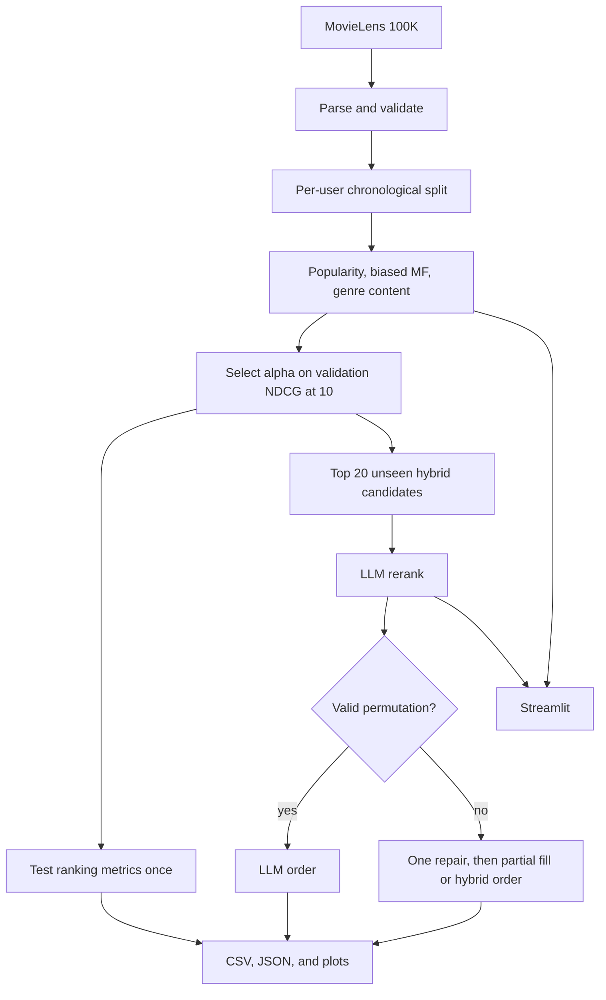

# Hybrid Movie Recommendation Using Matrix Factorization and LLM-Based Reranking

Course project for one developer over four weeks. The repository root is the project root. A local `ml-100k/` directory was already present, so the code lives here instead of in a nested `movie-recommender/` folder.

## Research question

Can LLM-based reranking improve the relevance, diversity, or interpretability of recommendations produced by a traditional hybrid movie recommender?

The comparison is:

| ID | System | What it uses |
| --- | --- | --- |
| 1 | Popularity | Training counts and a Bayesian average |
| 2 | Biased matrix factorization | Collaborative ratings only |
| 3 | Genre content | Multi-hot genres and a weighted user profile |
| 4 | Hybrid | Normalized MF plus content, with alpha chosen on validation |
| 5 | Hybrid + LLM rerank | The hybrid top-20, reordered by an LLM |
| 6 | Explanations | One sentence per final recommendation, with a template fallback |

A negative LLM result is a valid result. The code reports the measured difference and a bootstrap interval. It does not assume reranking helps.

## Architecture



Provider-specific HTTP code is isolated in `OpenAICompatibleClient` inside [src/movie_recommender/llm/client.py](src/movie_recommender/llm/client.py). To support a different protocol, implement `ChatClient.chat` and pass that object to `LLMGateway`. The gateway already applies the cache, the rate limit, retries, and the call budget. This project does not pick a provider URL.

## Dataset

MovieLens 100K: 100,000 ratings from 943 users on 1,682 movies, collected by GroupLens from September 1997 through April 1998. Each user has at least 20 ratings. Ratings are integers from 1 to 5.

Files used:

- `u.data`: tab-separated `user id`, `movie id`, `rating`, Unix `timestamp`
- `u.item`: the original pipe-delimited movie file, read as latin-1. The GroupLens README text says the file is tab-separated; the distributed file is pipe-delimited. The parser accepts either delimiter when the row has 24 fields.
- Columns: movie id, title, release date, empty video-release date, IMDb URL, and 19 genre flags from `unknown` through `Western`

The release year is parsed from the trailing `(YYYY)` in the title, then from the release date if needed.

The dataset is not redistributed in git. `ml-100k/` and `data/raw/` are ignored. Cite Harper and Konstan, 2015, *The MovieLens Datasets: History and Context*, ACM TiiS.

## Installation

Python 3.11 or newer is required. This environment was exercised with Python 3.12 because current PyTorch wheels are more reliable there than on very new interpreters.

```bash
python3.12 -m venv .venv
source .venv/bin/activate
pip install -r requirements.txt
```

`pip install -e .` also works. Scripts add `src/` to the import path, so an editable install is optional.

## API configuration

Copy the example file and fill it in locally. Never commit the filled file.

```bash
cp .env.example .env
```

```text
LLM_API_KEY=
LLM_BASE_URL=
LLM_MODEL=qwen35-27b
```

`LLM_BASE_URL` is the server root that prefixes `/chat/completions`. If the server already documents a base such as `https://host.example/v1`, use that value. Do not invent a host. The client posts to `{LLM_BASE_URL}/chat/completions` with `Authorization: Bearer <key>`.

If either the key or the base URL is missing, live LLM calls are disabled and a clear error is logged. Popularity, matrix factorization, content, hybrid, and the Streamlit cold-start path keep working. Tests and `run_pipeline.py` use a mock client and do not read a real key.

The key is not hard-coded, not written to the SQLite cache, and stripped from log lines if it ever appears. Request headers are not logged. HTTP errors are re-raised as short status messages without the request object.

## Data split

Relevant means rating greater than or equal to 4.

For each user:

1. Sort interactions by timestamp, then movie id.
2. Find relevant interactions.
3. Hold out the latest relevant interaction as the test item.
4. Hold out the second-latest relevant interaction as the validation item.
5. Train on interactions that sort strictly before the validation key.
6. Drop the user unless that training history contains at least 3 relevant ratings.

Interactions between validation and test, and anything after the test item, are discarded. They are not training features and they are not labels.

Validation is used for matrix-factorization early stopping (RMSE) and for choosing alpha (NDCG@10). The test split is scored once after those choices. Sharing one validation set for both choices can make the validation ranking numbers slightly optimistic for the chosen epoch. That limitation is accepted and disclosed. There is no third nested split.

`prepare_data.py` writes `data/processed/` and `artifacts/metrics/split_summary.json` with eligible users, train/validation/test counts, removed users, sparsity, and the rating distribution.

## Models

### Popularity

Fit on training rows only. Two scores are available:

- Positive count: number of training ratings at or above the relevance threshold.
- Bayesian average with prior strength `C = 10` pseudo-ratings at the training global mean:

```text
bayes_i = (C * mu + sum of observed training ratings) / (C + n_i)
```

Movies with no training ratings get `mu` under the Bayesian score and 0 under the positive-count score. The reported popularity baseline uses the Bayesian score. Ties break toward the smaller movie id. Movies already in the user's training history are removed.

### Biased matrix factorization

```text
r_hat(u, i) = mu + b_u + b_i + p_u · q_i
```

PyTorch embeddings for users and movies, plus both biases. `mu` is the training-rating mean. Every catalog movie has an item vector, including movies that never appear in training, so a cold item can still be scored. The objective on each mini-batch is mean squared error plus L2 on the batch embeddings and biases. Optimization is mini-batch SGD at the configured learning rate, with gradient clipping at 5. Early stopping restores the epoch with the best validation NDCG@10. Validation RMSE and MAE are still plotted and reported, but they are a poor stopping rule here: every validation label is a relevant rating of at least 4, so that RMSE is not on the same scale as training error. Checkpoints are `artifacts/models/mf.pt` and `artifacts/models/mf_metadata.json`.

CPU is the default for the smoke command. CUDA is used when available, then Apple MPS, then CPU. GPU kernels can still be nondeterministic; the seed is set anyway. RMSE and MAE are saved as secondary rating metrics. Ranking metrics are the primary comparison.

### Content

Each movie is a 19-dimensional multi-hot genre vector. A user's profile is the weighted average of training movies with

```text
w_ui = max(r_ui - 3, 0)
```

So a 4 contributes weight 1 and a 5 contributes weight 2. The movie score is cosine similarity. If the profile is all zeros, content scores fall back to the Bayesian popularity score and the run records that fallback. Seen movies are excluded.

### Hybrid

Matrix-factorization scores and content scores are min-max normalized separately for each user over that user's unseen catalog. A constant score vector becomes 0.5 so it does not invent an order.

```text
s_hybrid(u, i) = alpha * s_MF(u, i) + (1 - alpha) * s_content(u, i)
```

Alpha is chosen from `0.0, 0.25, 0.5, 0.75, 1.0` by mean validation NDCG@10. Ties prefer the value closest to 0.5, then the smaller alpha. The selected alpha is applied once on the test set.

## LLM reranking

The LLM never scores the full catalog and is not trained or fine-tuned. It receives:

- up to 10 highest-rated training movies
- up to 5 lowest-rated training movies
- up to 5 most recent positively rated training movies
- preferred genres from the training profile
- exactly the hybrid candidate list, with title, year, and genres

Numeric model scores stay in the candidate records for analysis and the UI. They are not placed in the prompt, so the model is not asked to copy the hybrid score. Held-out validation and test labels are not placed in the prompt. The builder raises if a held-out movie id is present in the history table.

Default prompts are far below the 262,100-token context window. The target is under about 8,000 tokens. A warning is logged if an estimate exceeds that. The estimate is characters divided by 4.

The model must return JSON only:

```json
{
  "ranked_movie_ids": [12, 45, 83],
  "reasoning_summary": "Short general explanation of the ranking."
}
```

`reasoning_summary` is a short user-facing note, not hidden chain-of-thought. Validation requires a JSON object, ids drawn only from the candidate set, no duplicates, and every candidate exactly once.

If validation fails:

1. One repair request is sent.
2. If the repair is a valid permutation, it is used.
3. If the repair contains some valid ids, those ids are kept and the missing candidates are appended in hybrid order.
4. If the repair contains no valid ids, the same completion is applied to the original response.
5. If the HTTP call fails, times out after retries, or the call budget is exhausted, the hybrid order is kept.

The fallback reason is stored. The API key is not.

Explanations, when requested, are one sentence, must mention the movie id, and may use only the supplied history and metadata. Mentions of actors, directors, certainty, hidden scores, or test labels are discarded in favor of a deterministic template.

### Cache, rate limit, and budget

The SQLite cache key is a hash of the model name, the prompt messages, the temperature, the task name (`rerank`, `repair`, or `explain`), and `PROMPT_VERSION` in `llm/prompts.py`. Bump that constant when the prompt text changes.

Cache lookups happen before rate limiting or a request. Successful normalized text is stored. `--refresh-cache` ignores reads and overwrites entries. An interrupted evaluation can be resumed because completed users are cache hits.

Live uncached requests are serial. The gap is at least 10 seconds and also respects 6 requests per minute, so the floor is 10 seconds. Retries of timeouts, HTTP 429, and HTTP 5xx use exponential backoff plus jitter and the same spacing. Other HTTP errors are not retried. The mock client does not sleep, because it is not an API call.

`--dry-run` prints the estimated uncached calls and does not contact a server. `--maximum-api-calls` stops cleanly; remaining users keep the hybrid order with reason `budget_exhausted`. A live run without `--confirm-api-calls` exits with status 2 after printing the estimate.

The default sample is 100 eligible users, drawn with the configured seed and then sorted. Smoke runs use 25. Ablations on candidate size (10 vs 20) and history mode (highest-rated, recent positives, combined) run automatically for the mock client. They stay off for live calls unless `--ablations` is passed, because they multiply the request count. Explanations in the offline mock run are limited to five users.

The mock reranker orders candidates by genre overlap with the prompt. Its metrics are a pipeline check, not a measurement of `qwen35-27b`.

## Metrics

Leave-one-out, one relevant item:

- Hit Rate@K and Recall@K are equal in this protocol. Both are 1 when the held-out movie is in the top K.
- NDCG@K is `1 / log2(rank + 1)` when the item is inside K, else 0. Ideal DCG is 1.
- MRR uses the full ranked list, not a truncated list. The LLM ranking is the reranked candidate head followed by the unchanged hybrid tail, so a movie outside the candidate set keeps its hybrid rank.
- Catalog coverage is the fraction of the catalog that appears in some user's top K.
- Genre diversity is the mean pairwise cosine distance among genre vectors in the top K, averaged over users.
- Average popularity is the mean training interaction count of the recommended movies.
- Novelty of an item is `-log2(p_i)`, where `p_i` is the fraction of training users who rated it. Unrated movies use `1 / (N + 1)`.

Bootstrap intervals are user-level percentile intervals from the configured number of resamples (1,000 by default, 200 in smoke). They are not p-values. The report states whether the 95% interval for the paired difference excludes zero, and whether that interval also lies entirely outside a descriptive margin of 0.01. A sample under 30 users is described as too small for a reliable conclusion.

The LLM can only reorder the hybrid candidate set. It cannot recover a relevant movie the hybrid model did not nominate. Hit rate can still change inside the top 5 or 10 when the relevant movie sits between ranks 6 and 20.

## Popularity buckets and sparse users

Training interaction counts, with movie id as a tie-break, split the catalog into three nearly equal groups: sparse tail, medium, and popular head. Test metrics are grouped by the bucket of the held-out movie.

A secondary check keeps only the earliest three positive training ratings, rebuilds the content profile, and compares content NDCG@10 on the same candidate pool. Matrix factorization is not retrained for that check, because the saved user embedding saw the full history. Genre metadata can help a short history. It cannot recommend for a user with no preference history.

## Reproduction

```bash
python scripts/download_data.py
python scripts/prepare_data.py --data-dir data/raw/ml-100k
python scripts/train_models.py --config configs/default.yaml
python scripts/evaluate_models.py --config configs/default.yaml
python scripts/evaluate_llm.py --config configs/default.yaml --dry-run
python scripts/evaluate_llm.py --config configs/default.yaml --maximum-api-calls 100 --confirm-api-calls
python scripts/run_pipeline.py --config configs/default.yaml --data-dir ml-100k
streamlit run app/streamlit_app.py
pytest
```

If MovieLens is already at `./ml-100k`, pass `--data-dir ml-100k`. The download script uses the GroupLens URL `https://files.grouplens.org/datasets/movielens/ml-100k.zip` and extracts into `data/raw/ml-100k`.

Useful flags:

- `--smoke` on `train_models.py`, `evaluate_llm.py`, and `run_pipeline.py` limits factorization to 5 epochs, 16 factors, patience 2, and the LLM sample to 25 users.
- `--device cpu|cuda|mps|auto`
- `--epochs` and `--latent-dimensions` on training
- `--mock-llm`, `--dry-run`, `--refresh-cache`, `--maximum-api-calls`, `--confirm-api-calls`
- `--sample-users`, `--ablations`, `--no-ablations`, `--explanations`

`run_pipeline.py` prepares, trains, evaluates, and then runs the mock LLM evaluation. It does not make a live call. Live calls require `python scripts/evaluate_llm.py ... --confirm-api-calls` or `run_pipeline.py --live-llm --confirm-api-calls`.

No real API call is made by the tests or by the default pipeline.

## Streamlit

```bash
streamlit run app/streamlit_app.py
```

The app needs the processed tables and saved models. A new demo user searches for movies, assigns ratings, and can request popularity, content, hybrid, or hybrid plus LLM reranking.

For that new user the hybrid score is `alpha * popularity + (1 - alpha) * content` after per-user normalization. The screen says this is a cold-start recommendation. There is no learned collaborative user embedding, and the matrix-factorization column is empty on purpose.

An optional existing-user mode uses that user's training history and trained embedding. It does not display held-out ratings.

Mock LLM is on by default. Live reranking requires both a configured API and the confirmation checkbox. If the API is unavailable, the page warns and shows the non-LLM ranking. Explanation failures use the template.

## Artifacts

| Path | Contents |
| --- | --- |
| `data/processed/` | Ratings, movies, genre matrix, train, validation, test, split summary |
| `artifacts/models/` | Popularity JSON, genre matrix, MF checkpoint, selected alpha, run metadata |
| `artifacts/cache/llm_cache.sqlite` | Response cache. No API key |
| `artifacts/metrics/` | Comparison CSV and JSON, per-user metrics, alpha table, buckets, sparse-user check, LLM comparison, results markdown |
| `artifacts/plots/` | Rating, activity, and popularity distributions; MF loss; alpha curve; model comparison; head/mid/tail; LLM displacement; quality versus API calls |

Every artifact above is produced by the commands in this README. Smoke outputs set `result_type` to `smoke` or `smoke_mock_llm`. Do not quote them as a fully trained run or as a result about `qwen35-27b`.

The results table is rewritten by `evaluate_models.py` and extended by `evaluate_llm.py` at [artifacts/metrics/results_table.md](artifacts/metrics/results_table.md). Copy that table into a report after the run you intend to cite. The smoke numbers from this workspace are recorded in the next section only after the command has been executed.

## Smoke-test results

Command:

```bash
python scripts/run_pipeline.py --config configs/default.yaml --data-dir ml-100k --smoke --device cpu
```

This is a smoke test. Factorization used 16 factors and stopped at epoch 3 of a 5-epoch cap because validation NDCG@10 stopped improving. The LLM block is the mock genre-overlap client on 25 users, with a cold cache. It is not a measurement of `qwen35-27b`.

Split: 938 eligible users, 5 removed, 94,527 training interactions, 938 validation, 938 test, 3,597 discarded. Sparsity of the cleaned data is 0.937.

Test ranking metrics on all 938 users, alpha 0.75 selected on validation:

| Model | HR@10 | NDCG@10 | MRR | Coverage@10 | Diversity@10 | Novelty@10 |
| --- | ---: | ---: | ---: | ---: | ---: | ---: |
| Popularity, Bayesian | 0.0405 | 0.0166 | 0.0165 | 0.0321 | 0.7399 | 2.3563 |
| Popularity, positive count | 0.0682 | 0.0343 | 0.0334 | 0.0565 | 0.6853 | 1.2981 |
| Matrix factorization | 0.0576 | 0.0281 | 0.0271 | 0.0571 | 0.6501 | 1.5703 |
| Content | 0.0213 | 0.0105 | 0.0130 | 0.2669 | 0.1334 | 4.5958 |
| Hybrid | 0.0544 | 0.0283 | 0.0290 | 0.0624 | 0.5446 | 1.6436 |

On this short run, positive-count popularity has the highest Hit Rate@10 and NDCG@10. The hybrid does not beat it. Content has the highest coverage and novelty and the lowest relevance. That is an offline result for an undertrained model, not a claim that popularity is the best possible system.

Secondary rating error for the factorization model: test RMSE 0.869, test MAE 0.738.

Mock rerank versus hybrid on the same 25 users: mean paired NDCG@10 difference 0.051, 95% bootstrap interval [0.000, 0.127]. The interval includes zero, and 25 users is too small for a reliable conclusion. The mock changed the top recommendation for 96% of the sample and moved candidate ranks by 4.74 positions on average. Invalid-response rate 0, fallback rate 0, cache-hit rate 0, about 893 prompt tokens, 105 uncached mock calls. Do not read the 0.051 difference as evidence that an LLM helps.

A secondary content-only sparsity check on 920 users changed mean NDCG@10 from 0.0108 with the full training profile to 0.0115 with only the earliest positive ratings. The difference is tiny. Short genre histories are not a substitute for a missing preference history.

The same tables are written to [artifacts/metrics/results_table.md](artifacts/metrics/results_table.md). Re-running the full 50-epoch schedule can change every number above.

## Testing

```bash
pytest
```

Tests cover parsing, the chronological split, leakage, seen-item filtering, popularity order, factorization shapes and checkpoints, content profiles, normalization, the hybrid formula, top-K metrics, JSON parsing, duplicate and invalid ids, missing-candidate completion, total request failure, cache contents, retry spacing, and one synthetic end-to-end smoke path. No test needs a network or a real key.

`tests/test_data.py` also parses a local `ml-100k` directory when that folder exists.

## Limitations

- MovieLens 100K genres are coarse flags. They do not encode plot, tone, cast, or direction. The explanation prompt is forbidden from inventing those attributes because the data does not contain them.
- Popularity bias is structural. The Bayesian prior and the hybrid's collaborative term both favor movies that many people rated. Head items will look easier to hit because the held-out relevant movie is itself something a user chose to rate, and those movies tend to be popular.
- A feedback loop is a deployment risk this offline split cannot see. If a system mostly recommends popular movies, future ratings concentrate on those movies, and the next model looks even more popular. Offline MovieLens ratings were not produced by this recommender.
- Relevance here means "the user rated this held-out movie 4 or 5 in 1997–1998." That is not satisfaction, watch completion, or a choice among the recommendations the system actually showed.
- API outputs are not a frozen dataset. A provider can change sampling, safety filters, or the model behind a name. Temperature 0 reduces but does not remove nondeterminism. The cache makes one recorded run repeatable. A later live run can differ. The mock client is deterministic and is labeled as a mock.
- A few hundred public users, or a 25-user smoke sample, cannot establish what a person wants. The ratings are historical, anonymous, and limited to movies those users happened to rate.
- A statistically significant online result from Netflix does not transfer here. Netflix had a different catalog, interface, feedback loop, objective, and user base. This project measures proxy ranking metrics on a 1998 research dataset. An interval that excludes zero on MovieLens would still not be evidence about a production service.

## Ethical considerations

The data are public research ratings, not a private profile. Do not try to re-identify users. Do not present a recommendation or an LLM sentence as a fact about a person's taste. Explanations must stay inside the supplied history. Do not ship an API key. Do not log prompts in a place that retains secrets. The rate limit and the confirmation flag exist so a class project does not accidentally send a large request volume.

## Cost control

- Six requests per minute, concurrency one, and at least ten seconds between uncached live calls.
- Cache before calling. Resume after an interruption.
- Dry run prints the uncached count first.
- Live calls require `--confirm-api-calls`.
- `--maximum-api-calls` stops the rest of the sample on the hybrid order.
- The LLM sees 20 candidates, not 1,682 movies.
- History is capped at 10 positive, 5 negative, and 5 recent titles.
- Live ablations and bulk explanations are off unless requested. The mock path explains at most five users.
- Temperature is 0.

## Troubleshooting

| Symptom | What to do |
| --- | --- |
| `u.data` not found | Pass `--data-dir` or run `download_data.py` |
| Processed files missing | Run `prepare_data.py` |
| Checkpoint missing | Run `train_models.py` |
| LLM disabled | Set `LLM_API_KEY` and `LLM_BASE_URL`, or pass `--mock-llm` |
| Live call refused | Add `--confirm-api-calls` after reading the dry-run estimate |
| HTTP 401 or 403 | The key or base URL is wrong. The client will not retry these |
| HTTP 429 | Retried with backoff. Lower the call budget if it persists |
| Streamlit says artifacts are missing | Run the smoke pipeline first |
| Results look identical for hybrid and LLM | The fallback path kept the hybrid order, or the mock agreed with it. Read `fallback_reason` in `llm_per_user.csv` |

## Four-week schedule

| Week | Focus |
| --- | --- |
| 1 | Parse MovieLens, validate ids and genres, implement the chronological split, write leakage tests, and plot the rating and popularity distributions |
| 2 | Popularity, biased matrix factorization, content profiles, hybrid alpha selection on validation, and offline ranking metrics |
| 3 | Provider-neutral client, cache, rate limit, prompts, repair and fallback, mock evaluation, and the small ablations |
| 4 | Head/mid/tail and sparse-user checks, Streamlit cold-start demo, README, and a full non-smoke training run if the schedule allows |

## Configuration

The central file is [configs/default.yaml](configs/default.yaml). Values there override the dataclass defaults. Command-line flags override the file for epochs, factors, device, smoke mode, and the LLM sample.
